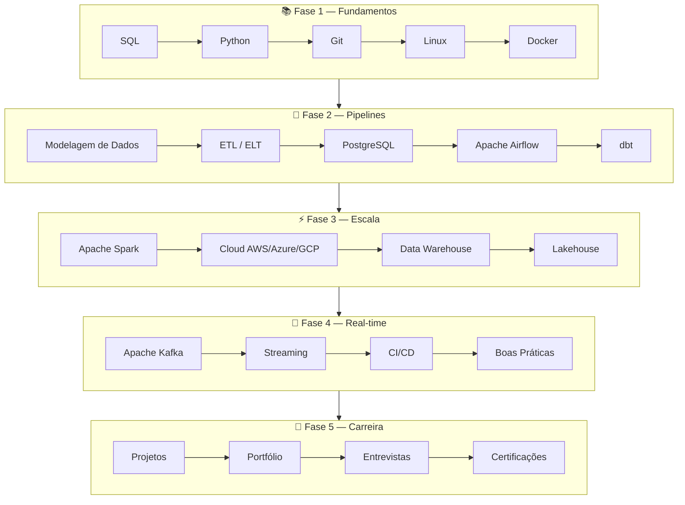

# Awesome Data Engineering BR 🇧🇷

> A curadoria definitiva em **português** sobre **engenharia de dados** e **data engineering** no Brasil. Aprenda, pratique e construa sua carreira como **engenheiro de dados** com roadmaps, tutoriais, projetos e recursos selecionados.

---

## 📑 Índice

- [Introdução](#-introdução)
  - [O que é Engenharia de Dados?](#o-que-é-engenharia-de-dados)
  - [O que faz um Engenheiro de Dados?](#o-que-faz-um-engenheiro-de-dados)
  - [Onde trabalha?](#onde-trabalha)
  - [Faixa salarial no Brasil](#faixa-salarial-no-brasil)
  - [Mercado brasileiro](#mercado-brasileiro)
  - [Data Engineer vs Analyst vs Scientist](#data-engineer-vs-data-analyst-vs-data-scientist)
- [Roadmap completo](#-roadmap-completo-de-engenharia-de-dados)
- [Tecnologias fundamentais](#-tecnologias-fundamentais)
  - [SQL](#sql) · [Python](#python) · [Git](#git) · [Linux](#linux) · [Docker](#docker)
  - [PostgreSQL](#postgresql) · [Apache Airflow](#apache-airflow) · [Apache Spark](#apache-spark)
  - [Kafka](#apache-kafka) · [dbt](#dbt) · [DuckDB](#duckdb) · [ClickHouse](#clickhouse)
  - [Databricks](#databricks) · [BigQuery](#bigquery) · [Snowflake](#snowflake)
  - [AWS](#aws) · [Azure](#azure) · [GCP](#gcp)
  - [Terraform](#terraform) · [CI/CD](#cicd)
  - [Data Modeling](#data-modeling) · [Data Warehouse](#data-warehouse) · [Lakehouse](#lakehouse)
  - [Streaming](#streaming) · [APIs e REST](#apis-e-rest)
  - [Parquet](#parquet) · [Iceberg](#apache-iceberg) · [Delta Lake](#delta-lake) · [Hive](#apache-hive)
- [Projetos para praticar](#-projetos-para-praticar)
- [Desafios](#-desafios)
- [Livros recomendados](#-livros-recomendados)
- [Canais do YouTube](#-canais-do-youtube)
- [Podcasts](#-podcasts)
- [Newsletters](#-newsletters)
- [Comunidades](#-comunidades)
- [Repositórios GitHub incríveis](#-repositórios-github-incríveis)
- [Cheatsheets](#-cheatsheets)
- [Entrevistas](#-entrevistas)
- [Certificações](#-certificações)
- [Glossário](#-glossário)
- [Documentação expandida](#-documentação-expandida)
- [Como contribuir](#-como-contribuir)

---

## 🎯 Introdução

Se você pesquisou **engenharia de dados**, **data engineering** ou **aprender engenharia de dados** em português, chegou ao lugar certo. Este repositório é mais do que uma lista de links — é um guia completo para se tornar **engenheiro de dados** no mercado brasileiro.

### O que é Engenharia de Dados?

**Engenharia de dados** é a disciplina que projeta, constrói e mantém a infraestrutura e os **pipelines de dados** que permitem coletar, transformar, armazenar e entregar dados confiáveis para análise, machine learning e produtos digitais.

Enquanto o **Data Analyst** consome dados para gerar insights e o **Data Scientist** constrói modelos preditivos, o **engenheiro de dados** garante que os dados existam, estejam corretos, acessíveis e no formato certo — no tempo certo.

A **engenharia de dados** envolve:

- Ingestão de dados de APIs, bancos, arquivos e streams
- Transformações **ETL** (Extract, Transform, Load) e **ELT** (Extract, Load, Transform)
- Modelagem de **data warehouse**, **data lake** e **lakehouse**
- Orquestração com **Apache Airflow** e ferramentas similares
- Processamento em escala com **Apache Spark**
- Streaming com **Kafka**
- Deploy em **cloud** (**AWS**, **Azure**, **GCP**)
- Governança, qualidade e observabilidade de dados

### O que faz um Engenheiro de Dados?

O dia a dia de um **engenheiro de dados** inclui:

| Atividade | Ferramentas comuns |
|-----------|-------------------|
| Escrever pipelines batch e streaming | Airflow, Spark, Kafka, Python |
| Modelar tabelas analíticas | SQL, dbt, Kimball/Inmon |
| Integrar fontes de dados | APIs REST, CDC, Fivetran/Airbyte |
| Otimizar performance de queries | SQL, Spark, índices, particionamento |
| Gerenciar infraestrutura de dados | Docker, Terraform, cloud |
| Garantir qualidade e SLA | Great Expectations, testes dbt, alertas |
| Documentar e catalogar dados | dbt docs, OpenMetadata, Confluence |

### Onde trabalha?

**Engenheiros de dados** trabalham em praticamente todo setor da economia brasileira:

- **Fintechs** — Nubank, Inter, C6, PicPay
- **E-commerce e varejo** — iFood, Mercado Livre, Magalu, Americanas
- **Bancos e seguros** — Itaú, Bradesco, Porto
- **Saúde e pharma** — startups de healthtech
- **Consultorias** — Deloitte, Accenture, Thoughtworks
- **Startups de tecnologia** — de Series A a unicórnios
- **Indústria e energia** — IoT e analytics operacional

### Faixa salarial no Brasil

Valores aproximados em 2025 (CLT, mercado nacional — variam por cidade e senioridade):

| Nível | Faixa mensal (R$) | Experiência |
|-------|-------------------|-------------|
| Júnior | R$ 5.000 – R$ 9.000 | 0–2 anos |
| Pleno | R$ 9.000 – R$ 16.000 | 2–5 anos |
| Sênior | R$ 16.000 – R$ 28.000 | 5+ anos |
| Staff / Principal | R$ 25.000 – R$ 40.000+ | Arquitetura e liderança técnica |

> 💡 **Nota:** Remuneração em PJ costuma ser 30–50% superior. São Paulo e remoto para empresas internacionais pagam acima da média.

### Mercado brasileiro

O mercado de **engenharia de dados Brasil** cresceu de forma acelerada nos últimos anos. Fatores que impulsionam a demanda:

- Adoção massiva de **cloud** (AWS lidera, GCP e Azure crescem)
- Migração de **ETL** legado para **ELT** com **dbt**
- Arquiteturas **lakehouse** com **Databricks**, **Delta Lake** e **Iceberg**
- Regulamentação (**LGPD**) exigindo governança de dados
- Democratização de ferramentas open source (**Airflow**, **Spark**, **Kafka**)

A combinação **SQL** + **Python** + **cloud** é o trio mais pedido em vagas de **engenheiro de dados** no LinkedIn Brasil.

### Data Engineer vs Data Analyst vs Data Scientist

| Aspecto | Data Engineer | Data Analyst | Data Scientist |
|---------|---------------|--------------|----------------|
| Foco principal | Infraestrutura e pipelines | Insights e relatórios | Modelos e ML |
| Linguagens | SQL, Python, Scala | SQL, Python/R | Python, R |
| Ferramentas | Airflow, Spark, dbt, cloud | BI, Excel, SQL | Jupyter, scikit-learn |
| Entrega | Tabelas, APIs, streams | Dashboards, análises | Modelos, experimentos |
| Perfil | Engenheiro de software | Analítico de negócio | Estatístico/ML |

> 💡 Começando agora? O módulo **Introdução à Engenharia de Dados** da trilha [DataEngineer.help](https://dataengineer.help) é um ótimo ponto de partida.

---

## 🗺️ Roadmap completo de Engenharia de Dados

O **roadmap engenharia de dados** abaixo mostra a ordem recomendada para **aprender engenharia de dados**. Detalhes expandidos em [`docs/roadmaps`](docs/roadmaps/README.md).

### Detalhamento por etapa

| Fase | Duração | Objetivo | Documentação |
|------|---------|----------|--------------|
| Fundamentos | 2–3 meses | SQL, Python, Git, Linux, Docker | [SQL](docs/sql/README.md) · [Python](docs/python/README.md) · [Recursos](docs/resources/README.md) |
| Pipelines | 2–3 meses | Modelagem, ETL, Airflow, dbt | [Airflow](docs/airflow/README.md) · [dbt](docs/dbt/README.md) |
| Escala | 3–4 meses | Spark, cloud, DW, lakehouse | [Spark](docs/spark/README.md) · [Cloud](docs/cloud/README.md) |
| Real-time | 2 meses | Kafka, streaming, CI/CD | [Kafka](docs/kafka/README.md) |
| Carreira | Contínuo | Projetos, entrevistas, certs | [Projetos](docs/projects/README.md) · [Entrevistas](docs/interview/README.md) |

---

## 🛠️ Tecnologias fundamentais

Cada tecnologia abaixo inclui contexto para você entender **por que aprender**, **quando usar** e onde encontrar recursos — sem precisar clicar em dezenas de links para entender o básico.

---

### SQL

**Descrição:** Linguagem declarativa para consultar e manipular dados em **bancos de dados** relacionais e **data warehouses**.

| | |
|---|---|
| **Por que aprender** | Habilidade nº 1 do **engenheiro de dados**. Presente em 100% das vagas. |
| **Quando usar** | Transformações, modelagem, validação, otimização de pipelines |
| **Importância** | ⭐⭐⭐⭐⭐ |

**Links:** [Documentação PostgreSQL](https://www.postgresql.org/docs/) · [SQLBolt](https://sqlbolt.com/) · [Guia completo](docs/sql/README.md) · [Livro: Learning SQL](https://www.oreilly.com/library/view/learning-sql-3rd/9781492057604/)

> 💡 Na trilha [DataEngineer.help](https://dataengineer.help), os módulos **SQL Essencial** e **SQL Avançado** cobrem do básico a joins e window functions.

---

### Python

**Descrição:** Linguagem principal de **python para dados** e **data engineering**, usada em praticamente todo o ecossistema moderno.

| | |
|---|---|
| **Por que aprender** | Airflow, Spark (PySpark), SDKs de cloud, APIs, testes |
| **Quando usar** | Pipelines, automação, integrações, processamento |
| **Importância** | ⭐⭐⭐⭐⭐ |

**Links:** [Python Docs PT-BR](https://docs.python.org/pt-br/3/) · [Pandas](https://pandas.pydata.org/) · [Guia completo](docs/python/README.md)

> 💡 A trilha [DataEngineer.help](https://dataengineer.help) inclui módulos de **Lógica de Programação (Python Básico)**, **Estruturas de Dados** e **Manipulação de Dados com Pandas**.

---

### Git

**Descrição:** Sistema de controle de versão distribuído. Base para colaboração em código de pipelines e infraestrutura.

| | |
|---|---|
| **Por que aprender** | Versionar DAGs, modelos dbt, Terraform e notebooks |
| **Quando usar** | Sempre — todo projeto profissional usa Git |
| **Importância** | ⭐⭐⭐⭐⭐ |

**Links:** [Pro Git (PT-BR)](https://git-scm.com/book/pt-br/v2) · [GitHub Skills](https://skills.github.com/) · [Recursos](docs/resources/README.md#git)

> 💡 O módulo **Git & GitHub para Engenheiros de Dados** está previsto na trilha [DataEngineer.help](https://dataengineer.help).

---

### Linux

**Descrição:** Sistema operacional dominante em servidores. Terminal, SSH e scripting são essenciais.

| | |
|---|---|
| **Por que aprender** | Servidores de Airflow, Spark, Kafka e cloud rodam Linux |
| **Quando usar** | Deploy, debug, automação, cron jobs |
| **Importância** | ⭐⭐⭐⭐ |

**Links:** [Linux Journey](https://linuxjourney.com/) · [Recursos](docs/resources/README.md#linux)

> 💡 O módulo **Shell Script: Introdução e Automação de Tarefas** na trilha [DataEngineer.help](https://dataengineer.help) cobre automação no terminal.

---

### Docker

**Descrição:** Plataforma de containers para empacotar aplicações com dependências isoladas.

| | |
|---|---|
| **Por que aprender** | Ambientes reproduzíveis para Airflow, Postgres, Spark local |
| **Quando usar** | Desenvolvimento local, CI/CD, deploy de serviços |
| **Importância** | ⭐⭐⭐⭐⭐ |

**Links:** [Docker Docs](https://docs.docker.com/) · [Docker Compose](https://docs.docker.com/compose/) · [Recursos](docs/resources/README.md#docker)

> 💡 O módulo **Docker e CI/CD para Dados** está previsto na trilha [DataEngineer.help](https://dataengineer.help).

---

### PostgreSQL

**Descrição:** **Banco de dados** relacional open source, referência para OLTP e staging em pipelines.

| | |
|---|---|
| **Por que aprender** | Mais usado em projetos reais; base para entender bancos |
| **Quando usar** | Aplicações transacionais, staging, protótipos, TimescaleDB |
| **Importância** | ⭐⭐⭐⭐⭐ |

**Links:** [PostgreSQL Tutorial](https://www.postgresqltutorial.com/) · [Docs](https://www.postgresql.org/docs/) · [Recursos](docs/resources/README.md#postgresql)

---

### Apache Airflow

**Descrição:** Plataforma de orquestração de workflows como DAGs em **Python**.

| | |
|---|---|
| **Por que aprender** | Padrão de mercado para agendar **pipelines de dados** batch |
| **Quando usar** | Orquestração centralizada, dependências entre jobs, SLA |
| **Importância** | ⭐⭐⭐⭐⭐ |

**Links:** [Airflow Docs](https://airflow.apache.org/docs/) · [Astronomer](https://www.astronomer.io/guides/) · [Guia completo](docs/airflow/README.md)

> 💡 O módulo **Apache Airflow do Zero** está previsto na trilha [DataEngineer.help](https://dataengineer.help).

---

### Apache Spark

**Descrição:** Motor de processamento distribuído para big data (batch e streaming).

| | |
|---|---|
| **Por que aprender** | Processar datasets que não cabem em uma máquina |
| **Quando usar** | ETL em escala, joins massivos, ML distribuído |
| **Importância** | ⭐⭐⭐⭐⭐ |

**Links:** [Spark Docs](https://spark.apache.org/docs/latest/) · [Guia completo](docs/spark/README.md)

> 💡 Na trilha [DataEngineer.help](https://dataengineer.help), o módulo **PySpark e DataFrames** aborda processamento distribuído na prática.

---

### Apache Kafka

**Descrição:** Plataforma distribuída de streaming de eventos para arquiteturas real-time.

| | |
|---|---|
| **Por que aprender** | Backbone de pipelines de streaming e desacoplamento |
| **Quando usar** | Eventos em tempo real, CDC, múltiplos consumidores |
| **Importância** | ⭐⭐⭐⭐ |

**Links:** [Kafka Docs](https://kafka.apache.org/documentation/) · [Confluent](https://docs.confluent.io/) · [Guia completo](docs/kafka/README.md)

> 💡 O módulo **Kafka e Streaming** está previsto na trilha [DataEngineer.help](https://dataengineer.help).

---

### dbt

**Descrição:** Ferramenta de transformação que aplica engenharia de software ao **SQL** no warehouse.

| | |
|---|---|
| **Por que aprender** | Padrão **ELT** moderno; testes, docs e lineage automáticos |
| **Quando usar** | Transformações SQL em Snowflake, BigQuery, Databricks |
| **Importância** | ⭐⭐⭐⭐⭐ |

**Links:** [dbt Docs](https://docs.getdbt.com/) · [dbt Learn](https://learn.getdbt.com/) · [Guia completo](docs/dbt/README.md)

> 💡 Os módulos **dbt – Fundamentos** e **dbt Avançado** estão previstos na trilha [DataEngineer.help](https://dataengineer.help).

---

### DuckDB

**Descrição:** **Banco de dados** analítico in-process, extremamente rápido para workloads OLAP locais.

| | |
|---|---|
| **Por que aprender** | Prototipar transformações, análise local, testes sem cloud |
| **Quando usar** | Datasets até centenas de GB em uma máquina |
| **Importância** | ⭐⭐⭐⭐ |

**Links:** [DuckDB Docs](https://duckdb.org/docs/) · [DuckDB + dbt](https://docs.getdbt.com/docs/core/connect-data-platform/duckdb-setup)

---

### ClickHouse

**Descrição:** **Banco de dados** colunar OLAP otimizado para queries analíticas ultra-rápidas.

| | |
|---|---|
| **Por que aprender** | Real-time analytics, logs, métricas de alta cardinalidade |
| **Quando usar** | Dashboards sub-segundo, event analytics |
| **Importância** | ⭐⭐⭐⭐ |

**Links:** [ClickHouse Docs](https://clickhouse.com/docs) · [Tutorial](https://clickhouse.com/docs/en/getting-started/quick-start)

---

### Databricks

**Descrição:** Plataforma unificada de analytics baseada em **Apache Spark** com **Delta Lake**.

| | |
|---|---|
| **Por que aprender** | Adoção crescente no Brasil; lakehouse managed |
| **Quando usar** | Spark managed, ML, colaboração em notebooks |
| **Importância** | ⭐⭐⭐⭐ |

**Links:** [Databricks Docs](https://docs.databricks.com/) · [Community Edition](https://community.cloud.databricks.com/) · [Certificação](https://www.databricks.com/learn/certification)

> 💡 O módulo **Introdução ao Databricks** da trilha [DataEngineer.help](https://dataengineer.help) é um bom próximo passo após SQL e Python.

---

### BigQuery

**Descrição:** **Data warehouse** serverless do **GCP**, com SQL ANSI e escalabilidade automática.

| | |
|---|---|
| **Por que aprender** | DW sem gerenciar servidores; integração nativa com GCP |
| **Quando usar** | Analytics em escala no Google Cloud |
| **Importância** | ⭐⭐⭐⭐ |

**Links:** [BigQuery Docs](https://cloud.google.com/bigquery/docs) · [BigQuery Sandbox](https://cloud.google.com/bigquery/docs/sandbox)

---

### Snowflake

**Descrição:** **Data warehouse** cloud-native com separação de storage e compute.

| | |
|---|---|
| **Por que aprender** | Líder de mercado em DW SaaS; forte com dbt |
| **Quando usar** | Enterprise DW, data sharing, multi-cloud |
| **Importância** | ⭐⭐⭐⭐⭐ |

**Links:** [Snowflake Docs](https://docs.snowflake.com/) · [Snowflake Free Trial](https://signup.snowflake.com/)

---

### AWS

**Descrição:** Amazon Web Services — plataforma de **cloud** mais adotada no Brasil corporativo.

| | |
|---|---|
| **Por que aprender** | Maior demanda em vagas; S3, Glue, Redshift, EMR, MWAA |
| **Quando usar** | Data lake (S3), ETL (Glue), DW (Redshift), Spark (EMR) |
| **Importância** | ⭐⭐⭐⭐⭐ |

**Serviços-chave:** S3 · Glue · Athena · Redshift · EMR · MWAA · Kinesis · Lambda · MSK

**Links:** [AWS Skill Builder](https://skillbuilder.aws/) · [Guia Cloud](docs/cloud/README.md)

---

### Azure

**Descrição:** Plataforma de **cloud** da Microsoft, forte em enterprise e governo.

| | |
|---|---|
| **Por que aprender** | Synapse, Data Factory, Databricks, Purview |
| **Quando usar** | Empresas Microsoft-first, governo, corporativo |
| **Importância** | ⭐⭐⭐⭐ |

**Serviços-chave:** Data Lake Gen2 · Synapse · Data Factory · Event Hubs · Purview

**Links:** [Microsoft Learn Azure Data](https://learn.microsoft.com/azure/data/)

---

### GCP

**Descrição:** Google Cloud Platform — destaque em **BigQuery** e analytics serverless.

| | |
|---|---|
| **Por que aprender** | BigQuery é referência; Dataflow, Composer, Pub/Sub |
| **Quando usar** | Analytics, ML integrado, startups Google-native |
| **Importância** | ⭐⭐⭐⭐ |

**Serviços-chave:** BigQuery · Cloud Storage · Dataflow · Composer · Pub/Sub · Dataproc

**Links:** [Google Cloud Skills Boost](https://www.cloudskillsboost.google/)

> 💡 O módulo **Google Cloud Platform para Dados** está previsto na trilha [DataEngineer.help](https://dataengineer.help).

---

### Terraform

**Descrição:** Ferramenta de Infrastructure as Code (IaC) para provisionar **cloud** de forma declarativa.

| | |
|---|---|
| **Por que aprender** | Ambientes reproduzíveis; padrão em times maduros |
| **Quando usar** | Criar S3, IAM, VPC, clusters, qualquer recurso cloud |
| **Importância** | ⭐⭐⭐⭐ |

**Links:** [Terraform Docs](https://developer.hashicorp.com/terraform/docs) · [Recursos](docs/resources/README.md#terraform)

> 💡 O módulo **Infra como Código (Terraform + dbt Cloud)** está previsto na trilha [DataEngineer.help](https://dataengineer.help).

---

### CI/CD

**Descrição:** Integração e entrega contínuas aplicadas a pipelines de dados e infraestrutura.

| | |
|---|---|
| **Por que aprender** | Deploy seguro de DAGs, modelos dbt e Terraform |
| **Quando usar** | Todo projeto em produção com múltiplos contribuidores |
| **Importância** | ⭐⭐⭐⭐ |

**Ferramentas:** GitHub Actions · GitLab CI · Jenkins · ArgoCD

**Links:** [Recursos CI/CD](docs/resources/README.md#cicd)

---

### Data Modeling

**Descrição:** Arte de estruturar dados para análise eficiente e compreensível.

| | |
|---|---|
| **Por que aprender** | Base de todo **data warehouse** e mart analítico |
| **Quando usar** | Ao projetar schemas, dimensões, fatos, métricas |
| **Importância** | ⭐⭐⭐⭐⭐ |

**Conceitos:** Modelagem dimensional (Kimball) · 3NF (Inmon) · Data Vault · One Big Table

**Livro essencial:** *The Data Warehouse Toolkit* — Ralph Kimball

> 💡 O módulo **Data Modeling e Normalização** da trilha [DataEngineer.help](https://dataengineer.help) aprofunda modelagem dimensional e normalização.

---

### Data Warehouse

**Descrição:** Repositório central otimizado para consultas analíticas (OLAP).

| | |
|---|---|
| **Por que aprender** | Destino final da maioria dos pipelines corporativos |
| **Quando usar** | BI, relatórios, métricas de negócio consolidadas |
| **Importância** | ⭐⭐⭐⭐⭐ |

**Opções:** Snowflake · BigQuery · Redshift · Synapse · ClickHouse

> 💡 O módulo **Conceitos de Data Lake e Data Warehouse** está previsto na trilha [DataEngineer.help](https://dataengineer.help).

---

### Lakehouse

**Descrição:** Arquitetura que combina flexibilidade do **data lake** com governança do **data warehouse**.

| | |
|---|---|
| **Por que aprender** | Tendência dominante; medallion architecture |
| **Quando usar** | Dados raw + transformados no mesmo storage (S3/ADLS) |
| **Importância** | ⭐⭐⭐⭐⭐ |

**Tecnologias:** Delta Lake · Iceberg · Hudi · Databricks · Spark

> 💡 A trilha [DataEngineer.help](https://dataengineer.help) terá o módulo **Tabelas Delta e Camadas Bronze/Silver/Gold** para arquitetura medallion.

---

### Streaming

**Descrição:** Processamento de dados em tempo real ou near real-time.

| | |
|---|---|
| **Por que aprender** | Fintech, IoT, personalização, detecção de fraude |
| **Quando usar** | Latência de segundos importa |
| **Importância** | ⭐⭐⭐⭐ |

**Stack:** Kafka · Spark Structured Streaming · Flink · Kinesis · Dataflow

---

### APIs e REST

**Descrição:** Interfaces para ingestão e entrega de dados entre sistemas.

| | |
|---|---|
| **Por que aprender** | Principal fonte de dados externos em pipelines |
| **Quando usar** | Ingestão de SaaS, webhooks, microserviços |
| **Importância** | ⭐⭐⭐⭐ |

**Ferramentas:** Python requests/httpx · FastAPI · Airbyte · Fivetran

> 💡 O módulo **APIs de Dados com Flask e FastAPI** está previsto na trilha [DataEngineer.help](https://dataengineer.help).

---

### Parquet

**Descrição:** Formato de arquivo colunar comprimido, padrão de fato em **data lakes**.

| | |
|---|---|
| **Por que aprender** | Storage eficiente; predicate pushdown; compatível com Spark |
| **Quando usar** | Armazenar dados processados em S3/GCS/ADLS |
| **Importância** | ⭐⭐⭐⭐⭐ |

**Links:** [Parquet Docs](https://parquet.apache.org/docs/)

---

### Apache Iceberg

**Descrição:** Formato de tabela open source com ACID, time travel e schema evolution.

| | |
|---|---|
| **Por que aprender** | Adoção crescente; alternativa open ao Delta |
| **Quando usar** | Lakehouse multi-engine (Spark, Flink, Trino) |
| **Importância** | ⭐⭐⭐⭐ |

**Links:** [Iceberg Docs](https://iceberg.apache.org/docs/latest/)

---

### Delta Lake

**Descrição:** Protocolo de storage layer com transações ACID sobre Parquet.

| | |
|---|---|
| **Por que aprender** | Padrão no ecossistema Databricks e Spark |
| **Quando usar** | UPSERT, MERGE, CDC no lake |
| **Importância** | ⭐⭐⭐⭐⭐ |

**Links:** [Delta.io](https://delta.io/) · [Delta Lake Docs](https://docs.delta.io/)

> 💡 Complementa o módulo **Tabelas Delta e Camadas Bronze/Silver/Gold** da trilha [DataEngineer.help](https://dataengineer.help).

---

### Apache Hive

**Descrição:** Data warehouse sobre Hadoop; SQL-like (HiveQL) para dados em HDFS.

| | |
|---|---|
| **Por que aprender** | Legado em empresas grandes; conceitos ainda em entrevistas |
| **Quando usar** | Ambientes Hadoop existentes |
| **Importância** | ⭐⭐⭐ |

**Links:** [Hive Docs](https://hive.apache.org/)

---

## ETL e ELT {#etl-e-elt}

**ETL** (Extract, Transform, Load) transforma dados *antes* de carregar no destino. **ELT** (Extract, Load, Transform) carrega dados brutos primeiro e transforma *dentro* do **data warehouse** — padrão moderno com **dbt**, **BigQuery** e **Snowflake**.

| Abordagem | Vantagem | Ferramentas |
|-----------|----------|-------------|
| ETL | Controle de transformação upstream | Informatica, Talend, Glue |
| ELT | Escala do warehouse; SQL versionado | dbt, SQL nativo |

> 💡 O módulo **ETL e Data Wrangling com Python** da trilha [DataEngineer.help](https://dataengineer.help) coloca esses conceitos em prática.

---

## 🚀 Projetos para praticar

Construir projetos reais é o caminho mais rápido para se tornar **engenheiro de dados**. Lista completa em [`docs/projects`](docs/projects/README.md).

> 💡 A seção **Projetos Práticos & Portfólio** da trilha [DataEngineer.help](https://dataengineer.help) inclui pipelines end-to-end com Kaggle, Airflow, BigQuery e Databricks.

| # | Projeto | Nível | Stack |
|---|---------|-------|-------|
| 1 | ETL CSV → PostgreSQL | Iniciante | Python, Pandas |
| 2 | Pipeline de API REST | Iniciante | requests, SQL |
| 3 | Dimensional model Northwind | Iniciante | SQL |
| 4 | Docker Compose: Postgres + Airflow | Iniciante | Docker |
| 5 | Web scraper agendado | Iniciante | Python, cron |
| 6 | CLI validador de CSV | Iniciante | Python, Pandera |
| 7 | GitHub Actions para SQL tests | Iniciante | CI/CD |
| 8 | Backup automatizado para S3 | Iniciante | Bash, AWS |
| 9 | Dashboard de data quality | Iniciante | SQL, Grafana |
| 10 | Análise exploratória automatizada | Iniciante | Pandas, Jupyter |
| 11 | Pipeline completo Airflow | Intermediário | Airflow, Python |
| 12 | Projeto dbt 3 camadas | Intermediário | dbt, DuckDB |
| 13 | Data lake local MinIO | Intermediário | Docker, Parquet |
| 14 | CDC Debezium + Kafka | Intermediário | Kafka, Docker |
| 15 | ETL serverless AWS | Intermediário | Lambda, S3, Athena |
| 16 | Pipeline GCP BigQuery | Intermediário | GCS, Cloud Functions |
| 17 | API de dados FastAPI | Intermediário | FastAPI, PostgreSQL |
| 18 | Monitoramento de freshness | Intermediário | Airflow, Slack |
| 19 | Great Expectations suite | Intermediário | Python, GE |
| 20 | Terraform data platform | Intermediário | Terraform, AWS |
| 21 | Lakehouse Delta Lake | Avançado | Spark, Delta, S3 |
| 22 | Kafka → Spark → Snowflake | Avançado | Streaming |
| 23 | Medallion architecture completa | Avançado | S3, Spark, dbt |
| 24 | ClickHouse real-time analytics | Avançado | Kafka, ClickHouse |
| 25 | Feature store simplificado | Avançado | Spark, Redis |
| 26 | Iceberg vs Delta benchmark | Avançado | Spark |
| 27 | Data catalog OpenMetadata | Avançado | Docker |
| 28 | Pipeline com LGPD | Avançado | Anonimização |
| 29 | Cost optimization dashboard | Avançado | Cloud APIs |
| 30 | IoT pipeline simulado | Avançado | MQTT, Kafka |
| 31 | Reverse ETL prototype | Avançado | dbt, APIs |
| 32 | Log aggregation platform | Avançado | ELK Stack |
| 33 | ML pipeline feature engineering | Avançado | Spark, MLflow |
| 34 | Multi-cloud abstraction | Avançado | Python |
| 35 | Data mesh por domínios | Avançado | dbt, múltiplos DWs |

---

## 🏋️ Desafios

Exercícios práticos para fixar conceitos de **engenharia de dados**. Faça no seu ritmo e publique soluções no GitHub.

> 💡 Os **Desafios Semanais (SQL, Python, ETL)** da trilha [DataEngineer.help](https://dataengineer.help) complementam esta lista.

### SQL
1. Dado um schema de e-commerce, escreva query para calcular LTV por cliente
2. Implemente SCD Type 2 para tabela de produtos
3. Encontre gaps em série temporal de vendas diárias
4. Otimize query com EXPLAIN — documente o antes/depois
5. Crie pivot table de vendas por mês e categoria

### Python
6. Processe arquivo CSV de 5 GB sem carregar tudo na memória
7. Crie decorator que loga tempo de execução de funções
8. Implemente retry com backoff exponencial para API
9. Escreva testes pytest para pipeline ETL
10. Parse JSON aninhado de API e normalize para DataFrame

### Airflow
11. Crie DAG com branch operator baseado em dia da semana
12. Implemente SLA miss callback com notificação
13. DAG que executa dbt run + test em sequência
14. Dynamic task mapping para processar lista de arquivos
15. Configure pool para limitar concorrência em tasks pesadas

### Spark
16. Join de 1B × 100M linhas — escolha estratégia e justifique
17. Implemente deduplicação com window functions
18. Leia JSON malformado com permissive mode e conte erros
19. Otimize shuffle partitions para job específico
20. Structured Streaming: agregação de eventos por janela de 5 min

### Arquitetura
21. Desenhe pipeline de ingestão para app com 10M DAU
22. Proponha estratégia de particionamento para tabela de 5 anos de logs
23. Como implementar CDC de PostgreSQL para data lake?
24. Desenhe data mesh para empresa com 5 unidades de negócio
25. Plano de disaster recovery para data warehouse

---

## 📚 Livros recomendados

Curadoria completa em [`docs/books`](docs/books/README.md).

### Iniciante
- *Fundamentals of Data Engineering* — Joe Reis & Matt Housley
- *Learning SQL* — Alan Beaulieu
- *The Data Warehouse Toolkit* — Ralph Kimball
- *Python Crash Course* — Eric Matthes

### Intermediário
- *Data Pipelines with Apache Airflow* — Bas Harenslak
- *Designing Data-Intensive Applications* — Martin Kleppmann
- *Analytics Engineering with dbt* — Randy Abernathy
- *Python for Data Analysis* — Wes McKinney

### Avançado
- *Spark: The Definitive Guide* — Bill Chambers
- *Kafka: The Definitive Guide* — Neha Narkhede
- *High Performance Spark* — Holden Karau
- *Data Mesh* — Zhamak Dehghani

---

## 📺 Canais do YouTube

### 🇧🇷 Brasileiros

| Canal | Foco |
|-------|------|
| [Brasilian Data Guys](https://www.youtube.com/@BrasilianDataGuys) | Engenharia de dados, carreira |
| [Data Hackers](https://www.youtube.com/@DataHackers) | Comunidade, entrevistas, dados |
| [Código Fonte TV](https://www.youtube.com/@CodigoFonteTV) | Programação incluindo Python |
| [Filipe Deschamps](https://www.youtube.com/@FilipeDeschamps) | Tecnologia e carreira dev |
| [Programação Dinâmica](https://www.youtube.com/@ProgramacaoDinamica) | Python, ML, dados |
| [Asimov Academy](https://www.youtube.com/@AsimovAcademy) | Python e dados |
| [TI do Bem](https://www.youtube.com/@tidobem) | Cloud e certificações |

### 🌍 Internacionais

| Canal | Foco |
|-------|------|
| [Seattle Data Guy](https://www.youtube.com/@SeattleDataGuy) | Data engineering tutorials |
| [Data with Zach](https://www.youtube.com/@DataWithZach) | dbt, analytics engineering |
| [Marc Lamberti](https://www.youtube.com/@MarcLamberti) | Apache Airflow |
| [Databricks](https://www.youtube.com/@databricks) | Spark, lakehouse |
| [Confluent](https://www.youtube.com/@confluent) | Kafka |
| [dbt Labs](https://www.youtube.com/@dbtLabs) | dbt e analytics engineering |
| [Alex The Analyst](https://www.youtube.com/@AlexTheAnalyst) | SQL, Excel, Tableau |

---

## 🎙️ Podcasts

| Podcast | Idioma | Foco |
|---------|--------|------|
| [Data Engineering Podcast](https://www.dataengineeringpodcast.com/) | EN | Entrevistas com engenheiros |
| [The Data Cloud Podcast (Snowflake)](https://www.snowflake.com/en/data-cloud-podcast/) | EN | Cloud data |
| [Analytics Engineering Podcast](https://roundup.getdbt.com/podcast) | EN | dbt e comunidade |
| [Data Hackers Podcast](https://datahackers.com.br/podcast/) | PT | Dados e carreira no Brasil |
| [Pizza de Dados](https://www.pizzadedados.com/) | PT | Estatística e dados |
| [Hipsters.tech](https://hipsters.tech/) | PT | Tecnologia (episódios de dados) |

---

## 📧 Newsletters

Detalhes em [`docs/newsletters`](docs/newsletters/README.md).

- [Data Engineering Weekly](https://www.dataengineeringweekly.com/) — curadoria semanal
- [Seattle Data Guy](https://seattledataguy.substack.com/) — tutoriais
- [The Analytics Engineering Roundup](https://roundup.getdbt.com/) — dbt
- [ByteByteGo](https://blog.bytebytego.com/) — system design
- [Data Hackers](https://datahackers.com.br/) — comunidade brasileira

---

## 👥 Comunidades

Participar de comunidades acelera sua carreira em **engenharia de dados Brasil**.

### Discord
- [Data Hackers](https://datahackers.com.br/) — comunidade BR de dados
- [dbt Community](https://www.getdbt.com/community/) — Slack oficial do dbt
- Busque por "Data Engineering Brasil" no Discord — comunidades ativas de dados

### Slack
- [dbt Community Slack](https://www.getdbt.com/community/join-the-community/)
- [Data Talks Club](https://datatalks.club/slack.html)

### Reddit
- [r/dataengineering](https://www.reddit.com/r/dataengineering/)
- [r/learndatascience](https://www.reddit.com/r/learndatascience/)
- [r/brdev](https://www.reddit.com/r/brdev/) — desenvolvimento no Brasil

### LinkedIn
- Grupos: "Engenharia de Dados Brasil", "Data Engineers"
- Siga: #dataengineering #engenhariadedados

### Telegram
- Grupos de Python Brasil
- Comunidades de cloud (AWS, GCP user groups BR)

---

## ⭐ Repositórios GitHub incríveis

Repositórios que todo **engenheiro de dados** deveria conhecer.

### Curadorias e roadmaps
- [awesome-data-engineering](https://github.com/igorbarinov/awesome-data-engineering)
- [data-engineer-roadmap](https://github.com/datastacktv/data-engineer-roadmap)
- [awesome-etl](https://github.com/pawl/awesome-etl)

### Ferramentas
- [apache/airflow](https://github.com/apache/airflow)
- [apache/spark](https://github.com/apache/spark)
- [apache/kafka](https://github.com/apache/kafka)
- [dbt-labs/dbt-core](https://github.com/dbt-labs/dbt-core)
- [duckdb/duckdb](https://github.com/duckdb/duckdb)
- [delta-io/delta](https://github.com/delta-io/delta)
- [apache/iceberg](https://github.com/apache/iceberg)

### Projetos para aprender
- [DataExpert-io/data-engineer-handbook](https://github.com/DataExpert-io/data-engineer-handbook)
- [marclourens/airflow-docker](https://github.com/puckel/docker-airflow) — Airflow local
- [dimasmukhlas/airflow-dbt-docker](https://github.com/dimasmukhlas/airflow-dbt-docker)
- [great-expectations/great_expectations](https://github.com/great-expectations/great_expectations)
- [OpenLineage/OpenLineage](https://github.com/OpenLineage/OpenLineage)

### SQL e entrevistas
- [DopplerHQ/awesome-interview-questions](https://github.com/DopplerHQ/awesome-interview-questions)
- [leetcode-sql](https://github.com/leetcode-sql/leetcode-sql)

### Cloud e IaC
- [terraform-aws-modules](https://github.com/terraform-aws-modules)
- [GoogleCloudPlatform/professional-services](https://github.com/GoogleCloudPlatform/professional-services)

### Brasileiros
- Repositórios de engenharia de dados de Nubank, iFood, QuintoAndar (busque por "data engineering" no GitHub)

---

## 📋 Cheatsheets

Referências rápidas para o dia a dia do **engenheiro de dados**.

| Tecnologia | Link |
|------------|------|
| SQL | [PostgreSQL Cheat Sheet](https://www.postgresqltutorial.com/postgresql-cheat-sheet/) |
| Python Pandas | [Pandas Cheat Sheet](https://pandas.pydata.org/Pandas_Cheat_Sheet.pdf) |
| Git | [GitHub Education Cheat Sheet](https://education.github.com/git-cheat-sheet-education.pdf) |
| Docker | [Docker Cheat Sheet](https://docs.docker.com/get-started/docker_cheatsheet.pdf) |
| Airflow | [Astronomer DAG Cheat Sheet](https://www.astronomer.io/airflow-guide/) |
| dbt | [dbt Cheat Sheet](https://docs.getdbt.com/guides/dbt-cheatsheet) |
| Spark | [Spark SQL Functions](https://spark.apache.org/docs/latest/api/sql/index.html) |
| Kafka | [Confluent Cheat Sheet](https://www.confluent.io/resources/cheat-sheet/) |
| AWS | [AWS CLI Cheat Sheet](https://docs.aws.amazon.com/cli/latest/userguide/cli-chap-welcome.html) |
| Terraform | [Terraform Cheat Sheet](https://developer.hashicorp.com/terraform/tutorials/cli/basic-cli-workflow) |

Mais em [`docs/resources`](docs/resources/README.md).

---

## 💼 Entrevistas

Preparação completa em [`docs/interview`](docs/interview/README.md).

### Perguntas frequentes gerais
- Diferença entre **ETL** e **ELT**?
- O que é idempotência e por que importa em pipelines?
- Batch vs streaming — trade-offs?
- Como garantir qualidade de dados em produção?
- Explique medallion architecture (bronze/silver/gold).

### SQL (amostra)
- Window functions: ROW_NUMBER vs RANK
- Otimize query com full table scan
- Implemente running total e moving average

### Python (amostra)
- Generators vs lists para arquivos grandes
- Como estruturar projeto ETL testável?
- GIL e multiprocessing

### Spark (amostra)
- O que causa shuffle? Como minimizar?
- Broadcast join — critérios de uso
- Cache vs persist — diferenças

### Airflow (amostra)
- XCom — quando usar e quando evitar
- Backfill vs catchup
- Como testar DAGs no CI?

### Arquitetura (amostra)
- Desenhe pipeline para e-commerce
- CDC: Debezium vs timestamp-based
- Data mesh vs data lake centralizado

---

## 🎓 Certificações

Certificações validam conhecimento em **cloud** e ferramentas — diferencial em processos seletivos.

### AWS
| Certificação | Nível | Foco |
|--------------|-------|------|
| AWS Certified Data Engineer – Associate | Associado | Pipelines, storage, analytics |
| AWS Solutions Architect – Associate | Associado | Arquitetura geral |
| AWS Certified Big Data – Specialty | Especialista | (legado, substituída) |

### Azure
| Certificação | Código |
|--------------|--------|
| Azure Data Engineer Associate | DP-203 |
| Azure Solutions Architect Expert | AZ-305 |

### Google Cloud
| Certificação | Código |
|--------------|--------|
| Professional Data Engineer | PDE |
| Associate Cloud Engineer | ACE |

### Databricks
- Databricks Certified Data Engineer Associate
- Databricks Certified Data Engineer Professional

### Snowflake
- SnowPro Core Certification
- SnowPro Advanced: Data Engineer

> 💡 **Dica:** Certificações associadas de cloud são o melhor ROI para quem está começando em **engenharia de dados**.

---

## 📖 Glossário

Mais de 150 termos essenciais de **engenharia de dados** e **data engineering**.

| Termo | Definição |
|-------|-----------|
| ACID | Atomicity, Consistency, Isolation, Durability — propriedades de transações |
| Airflow | Plataforma de orquestração de workflows em Python |
| Analytics Engineering | Disciplina de transformar dados com práticas de engenharia de software |
| API | Application Programming Interface — interface entre sistemas |
| Avro | Formato de serialização com schema evolution |
| AWS | Amazon Web Services — plataforma de cloud |
| Azure | Plataforma de cloud da Microsoft |
| Backfill | Reprocessamento de dados históricos em pipeline |
| Batch | Processamento de dados em lotes agendados |
| BigQuery | Data warehouse serverless do GCP |
| Bronze Layer | Camada raw no lakehouse/medallion |
| CDC | Change Data Capture — captura de alterações em banco |
| CI/CD | Continuous Integration / Continuous Delivery |
| ClickHouse | Banco colunar OLAP de alta performance |
| Cloud | Computação em nuvem (IaaS, PaaS, SaaS) |
| Columnar | Armazenamento por colunas (vs row-based) |
| Composer | Airflow managed do GCP |
| Conformed Dimension | Dimensão padronizada entre fatos |
| DAG | Directed Acyclic Graph — grafo de tarefas no Airflow |
| Data Catalog | Inventário de metadados de dados |
| Data Engineer | Profissional que constrói infraestrutura e pipelines de dados |
| Data Lake | Repositório de dados brutos em escala |
| Data Lineage | Rastreamento de origem e transformações de dados |
| Data Mart | Subconjunto do DW focado em domínio |
| Data Mesh | Arquitetura descentralizada orientada a domínios |
| Data Modeling | Processo de estruturar dados para análise |
| Data Pipeline | Sequência automatizada de ingestão e transformação |
| Data Quality | Conjunto de práticas para garantir confiabilidade |
| Data Vault | Modelagem para enterprise data warehouse |
| Data Warehouse | Repositório otimizado para OLAP |
| Databricks | Plataforma unificada de analytics com Spark |
| dbt | data build tool — transformações SQL versionadas |
| Dead Letter Queue | Fila para mensagens que falharam no processamento |
| Delta Lake | Formato de tabela ACID sobre Parquet |
| Denormalization | Desnormalização para performance analítica |
| Dimension Table | Tabela de dimensão na modelagem Kimball |
| Docker | Plataforma de containers |
| DuckDB | Banco analítico in-process |
| ELT | Extract, Load, Transform |
| EMR | Elastic MapReduce — Spark managed da AWS |
| ETL | Extract, Transform, Load |
| Fact Table | Tabela de fatos com métricas e chaves estrangeiras |
| Flink | Motor de stream processing |
| GCP | Google Cloud Platform |
| Git | Sistema de controle de versão |
| Glue | ETL serverless da AWS |
| Gold Layer | Camada de dados prontos para consumo |
| Governance | Políticas e processos de gestão de dados |
| Great Expectations | Framework de validação de dados |
| Hadoop | Ecossistema de big data (HDFS, MapReduce) |
| Hive | Data warehouse sobre Hadoop |
| Iceberg | Formato de tabela open source |
| Idempotency | Propriedade de operação repetível sem efeitos colaterais |
| Ingestion | Processo de coleta e carregamento de dados |
| IoT | Internet of Things — dados de sensores |
| JDBC | Java Database Connectivity — protocolo de banco |
| JSON | JavaScript Object Notation — formato semi-estruturado |
| Kafka | Plataforma de streaming de eventos |
| Kimball | Ralph Kimball — modelagem dimensional |
| Kinesis | Streaming da AWS |
| Kubernetes | Orquestrador de containers |
| Lakehouse | Arquitetura lake + warehouse |
| Lambda Architecture | Batch + speed layer para streaming |
| LGPD | Lei Geral de Proteção de Dados (Brasil) |
| Linux | Sistema operacional open source |
| Looker | Plataforma de BI do Google |
| MapReduce | Modelo de programação distribuída (legado) |
| Medallion | Arquitetura bronze/silver/gold |
| MERGE | Operação UPSERT em SQL |
| Metabase | Ferramenta de BI open source |
| Metadata | Dados sobre dados |
| MLflow | Plataforma de ciclo de vida de ML |
| MSK | Managed Streaming for Kafka (AWS) |
| MWAA | Managed Workflows for Apache Airflow |
| Normalization | Organização de dados em tabelas sem redundância |
| OLAP | Online Analytical Processing |
| OLTP | Online Transaction Processing |
| OpenMetadata | Data catalog open source |
| ORC | Optimized Row Columnar — formato de arquivo |
| Parquet | Formato colunar comprimido |
| Partition | Divisão de dados para performance |
| PostgreSQL | Banco relacional open source |
| Power BI | Ferramenta de BI da Microsoft |
| Prefect | Orquestrador de workflows (alternativa ao Airflow) |
| Pub/Sub | Mensageria do GCP |
| PySpark | API Python do Apache Spark |
| Python | Linguagem de programação para dados |
| Query | Consulta a dados |
| RDS | Relational Database Service (AWS) |
| Redshift | Data warehouse da AWS |
| REST | Representational State Transfer — padrão de API |
| RDD | Resilient Distributed Dataset (Spark legado) |
| S3 | Simple Storage Service (AWS) |
| Schema | Estrutura/definição de dados |
| Schema Evolution | Mudança de schema ao longo do tempo |
| SCD | Slowly Changing Dimension |
| SDK | Software Development Kit |
| Serverless | Execução sem gerenciar servidores |
| Silver Layer | Camada de dados limpos e validados |
| SLA | Service Level Agreement |
| Snowflake | Data warehouse cloud-native |
| Spark | Motor de processamento distribuído |
| SQL | Structured Query Language |
| Star Schema | Modelo estrela (fato + dimensões) |
| Streaming | Processamento de dados em tempo real |
| Superset | Plataforma de BI da Apache |
| Synapse | Analytics service da Azure |
| Tableau | Ferramenta de visualização de dados |
| Terraform | Infrastructure as Code |
| TimescaleDB | Extensão time-series do PostgreSQL |
| Trino | Query engine distribuído (ex-Presto) |
| UPSERT | Update + Insert combinados |
| VPC | Virtual Private Cloud |
| Window Function | Função analítica SQL (OVER PARTITION BY) |
| YAML | Formato de configuração legível |
| Zero-ETL | Integração direta sem pipeline tradicional |
| 3NF | Terceira forma normal — normalização |
| ADLS | Azure Data Lake Storage |
| Airbyte | Ferramenta open source de ingestão |
| Anomaly Detection | Detecção de anomalias em dados |
| Apache Beam | Modelo unificado batch/streaming |
| Arrow | Formato colunar em memória |
| Athena | SQL serverless sobre S3 |
| Atomic Swap | Troca atômica de tabelas |
| Avro Schema | Definição de estrutura Avro |
| Bottleneck | Gargalo de performance |
| Boto3 | SDK Python da AWS |
| Cardinality | Número de valores únicos em coluna |
| Cassandra | Banco NoSQL distribuído |
| Catalog | Catálogo de metadados |
| Chunking | Processamento em pedaços |
| Cluster | Conjunto de máquinas trabalhando juntas |
| Compression | Compressão de dados (Snappy, Gzip, ZSTD) |
| Concurrency | Execução paralela |
| Connection Pool | Pool de conexões de banco |
| Container | Unidade isolada de execução (Docker) |
| Cron | Agendador de tarefas Unix |
| CSV | Comma-Separated Values |
| Cursor | Ponteiro de leitura em banco |
| Data Contract | Acordo formal sobre formato de dados |
| Data Drift | Mudança na distribuição de dados |
| Data Fabric | Arquitetura integrada de gestão de dados |
| Data Observability | Monitoramento de saúde dos dados |
| DataOps | DevOps aplicado a dados |
| Data Product | Produto de dados com SLA e ownership |
| Data Retention | Política de retenção de dados |
| Dataproc | Spark managed do GCP |
| Deduplication | Remoção de registros duplicados |
| Denodo | Plataforma de virtualização de dados |
| Deployment | Implantação de software/infraestrutura |
| DistCP | Distributed Copy (Hadoop) |
| Driver | Processo principal do Spark |
| DynamoDB | Banco NoSQL da AWS |
| Executor | Worker do Spark |
| Explode | Função para expandir arrays em Spark SQL |
| Fivetran | Ferramenta comercial de ingestão |
| Flatten | Achatar estruturas aninhadas |
| GCS | Google Cloud Storage |
| Geospatial | Dados com localização geográfica |
| GitHub Actions | CI/CD do GitHub |
| Glue Catalog | Catálogo de metadados AWS |
| Granularity | Nível de detalhe dos dados |
| HDFS | Hadoop Distributed File System |
| Helm | Gerenciador de pacotes Kubernetes |
| Hot Path | Caminho de baixa latência |
| Hudi | Formato de tabela (Apache Hudi) |
| IAM | Identity and Access Management |
| Iceberg Catalog | Registro de tabelas Iceberg |
| Index | Estrutura para acelerar queries |
| Inmon | Bill Inmon — modelagem corporativa |
| JAR | Java Archive — pacote Spark |
| Job | Tarefa de processamento |
| JSON Lines | JSON com um objeto por linha |
| Jinja | Template engine usada no dbt |
| Kerberos | Protocolo de autenticação |
| Key-Value Store | Banco chave-valor (Redis, DynamoDB) |
| Kimball Bus Matrix | Matriz de dimensões conformadas |
| KSQL | SQL sobre streams Kafka |
| Lake Formation | Governança de data lake AWS |
| Late Arriving Data | Dados que chegam fora de ordem |
| Log | Registro de eventos |
| Lookup Table | Tabela de referência para enriquecimento |
| Manifest File | Arquivo de metadados (Iceberg/Delta) |
| Materialized View | View pré-computada e armazenada |
| MongoDB | Banco de documentos NoSQL |
| MQTT | Protocolo IoT leve |
| Namespace | Espaço de nomes (schema, database) |
| Node | Nó em cluster ou grafo |
| Null Handling | Tratamento de valores nulos |
| ODBC | Open Database Connectivity |
| OOM | Out of Memory — erro de memória |
| OpenLineage | Padrão aberto de lineage |
| Orchestration | Coordenação de workflows |
| Parquet Metadata | Metadados embutidos no Parquet |
| Pentaho | Ferramenta ETL (legado) |
| Pivot | Transformar linhas em colunas |
| Predicate Pushdown | Filtro aplicado antes da leitura |
| Producer | Componente que envia mensagens (Kafka) |
| Purview | Data governance da Azure |
| PyArrow | Biblioteca Python para Arrow |
| Query Engine | Motor de execução de SQL |
| Queue | Fila de mensagens |
| RBAC | Role-Based Access Control |
| Redis | Banco in-memory chave-valor |
| Replication | Cópia de dados para redundância |
| Reverse ETL | Sincronizar DW de volta para SaaS |
| Row Group | Grupo de linhas no Parquet |
| Sagemaker | ML platform da AWS |
| Sandbox | Ambiente isolado para testes |
| Scheduler | Agendador de jobs |
| Schema Registry | Registro de schemas (Kafka) |
| Seed | Dados estáticos versionados (dbt) |
| Semaphore | Controle de concorrência |
| Serde | Serializer/Deserializer |
| Shard | Partição em banco distribuído |
| Snapshot | Captura pontual de dados (Iceberg/Delta) |
| Snappy | Algoritmo de compressão |
| Snowpark | Runtime de processamento Snowflake |
| Source | Fonte de dados upstream |
| Staging | Área intermediária de dados |
| Staging Area | Zona de aterrissagem antes do DW |
| Steward | Responsável por qualidade de dados |
| Straggler | Task mais lenta em job paralelo |
| Subquery | Consulta aninhada |
| Surrogate Key | Chave artificial substituta |
| Synapse Pipeline | Orquestração Azure |
| Talend | Ferramenta ETL comercial |
| Task | Unidade de trabalho no Airflow |
| Throughput | Taxa de processamento |
| Time Travel | Consulta a versões anteriores (Delta/Iceberg) |
| Timestamp | Marca temporal |
| Topic | Canal Kafka |
| Transformation | Modificação de dados |
| Trigger | Disparador de pipeline |
| UDF | User Defined Function |
| Unnest | Expandir arrays em SQL |
| Uptime | Tempo de disponibilidade |
| UUID | Identificador único universal |
| Vacuum | Limpeza de arquivos obsoletos (Delta) |
| View | Tabela virtual definida por query |
| Watermark | Controle de atraso em streaming |
| Webhook | Callback HTTP para eventos |
| Worker | Processo executor em cluster |
| XCom | Cross-communication no Airflow |
| YAML Config | Configuração em YAML |
| ZSTD | Algoritmo de compressão moderno |

---

## 📂 Documentação expandida

Este repositório foi estruturado para crescer. Cada pasta possui README próprio com **internal linking** para SEO:

| Pasta | Conteúdo |
|-------|----------|
| [`docs/sql`](docs/sql/README.md) | SQL para engenharia de dados |
| [`docs/python`](docs/python/README.md) | Python para dados |
| [`docs/airflow`](docs/airflow/README.md) | Orquestração com Airflow |
| [`docs/spark`](docs/spark/README.md) | Processamento distribuído |
| [`docs/kafka`](docs/kafka/README.md) | Streaming e eventos |
| [`docs/dbt`](docs/dbt/README.md) | Transformação ELT |
| [`docs/cloud`](docs/cloud/README.md) | AWS, Azure, GCP |
| [`docs/roadmaps`](docs/roadmaps/README.md) | Trilhas de estudo |
| [`docs/interview`](docs/interview/README.md) | Preparação para entrevistas |
| [`docs/projects`](docs/projects/README.md) | Ideias de portfólio |
| [`docs/books`](docs/books/README.md) | Livros por nível |
| [`docs/newsletters`](docs/newsletters/README.md) | Newsletters curadas |
| [`docs/resources`](docs/resources/README.md) | Git, Linux, Docker, Terraform |

---

## 🤝 Como contribuir

Contribuições são bem-vindas! Leia o [CONTRIBUTING.md](CONTRIBUTING.md) para saber como adicionar recursos, corrigir links e melhorar conteúdo.

### Diretrizes rápidas
- Mantenha descrições em **português brasileiro**
- Adicione contexto, não apenas links
- Verifique se o recurso está ativo antes de incluir
- Siga o padrão de formatação existente

---

## 📄 Licença

Este trabalho está licenciado sob [Creative Commons Attribution 4.0 International (CC BY 4.0)](LICENSE).

---

  <strong>Feito com ❤️ para a comunidade brasileira de Engenharia de Dados</strong> 
  Se este repositório te ajudou, considere dar uma ⭐

