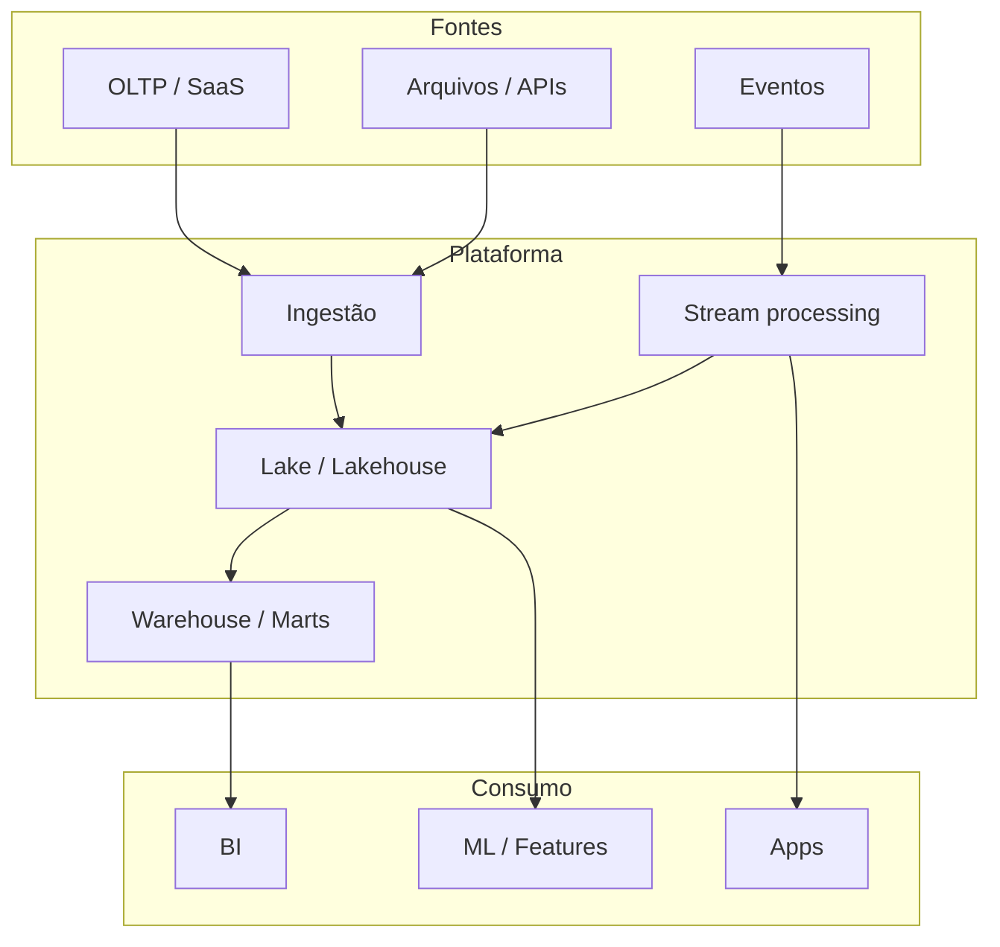

# Arquitetura de Dados — Batch, Stream, Lakehouse e Padrões

> Domine **arquitetura de dados**: padrões **batch**, **streaming**, **Lambda/Kappa**, **lakehouse** e decisões de desenho para **engenharia de dados**.

[← Índice](../../README.md) · [ETL](../etl/README.md) · [Streaming](../streaming/README.md) · [Lakehouse](../lakehouse/README.md) · [Data Warehouse](../data-warehouse/README.md) · [Cloud](../cloud/README.md)

---

## Por que estudar arquitetura de dados?

Ferramentas mudam; **padrões** permanecem. Saber quando usar batch vs stream, lake vs warehouse e como isolar camadas evita retrabalho e custo explosivo.

Um **engenheiro de dados** arquiteta para:

- Atender SLAs de latência e custo
- Separar ingestão, processamento e serving
- Evoluir de monolito de jobs para plataformas
- Comunicar trade-offs com stakeholders

**Importância:** ⭐⭐⭐⭐⭐

---

## O que você precisa dominar

| Tópico | Nível | Descrição |
|--------|-------|-----------|
| Batch vs streaming | ⭐⭐⭐⭐⭐ | Latência, custo, complexidade |
| Camadas (bronze/silver/gold) | ⭐⭐⭐⭐⭐ | Medallion / staged DW |
| Lambda e Kappa | ⭐⭐⭐⭐ | Arquiteturas clássicas de stream |
| Lakehouse | ⭐⭐⭐⭐⭐ | Lake + ACID + BI |
| OLTP / OLAP / serving | ⭐⭐⭐⭐⭐ | Poliglota de stores |
| Contratos e ownership | ⭐⭐⭐⭐ | Domínios e data mesh (visão) |
| Observabilidade | ⭐⭐⭐⭐ | Lineage, qualidade, custo |

---

## Quando usar cada padrão

| Padrão | Use quando | Evite quando |
|--------|------------|--------------|
| **Batch diário** | Relatórios, custo baixo | Fraude em segundos |
| **Micro-batch** | Quase real-time com Spark | Sub-segundo rígido |
| **Streaming** | Eventos contínuos, alertas | Time sem operação 24/7 |
| **Lambda** | Batch histórico + speed layer | Complexidade dupla dói |
| **Kappa** | Tudo via log reprocessável | Batch simples basta |
| **Lakehouse** | Unificar lake + BI/SQL | Só OLTP transacional |

---

## Recursos recomendados

### Livros e referências
- *Fundamentals of Data Engineering* — Reis & Housley
- *Designing Data-Intensive Applications* — Kleppmann
- Artigos Databricks sobre medallion architecture

### Guias do repositório
- [Lakehouse](../lakehouse/README.md) · [ETL](../etl/README.md) · [Streaming](../streaming/README.md)
- [Data Warehouse](../data-warehouse/README.md) · [Cloud](../cloud/README.md)

### Projetos
- Desenhar C4/contexto de um pipeline ponta a ponta
- Comparar custo batch vs stream para o mesmo SLA
- RFC de arquitetura (ver [Comunicação](../communication/README.md))

---

## Visão de referência (alto nível)

---

## Camadas — checklist mental

| Camada | Conteúdo | Consumidor típico |
|--------|----------|-------------------|
| **Bronze / raw** | Espelho da fonte, append | Engenheiros, reprocessamento |
| **Silver / cleaned** | Tipado, deduplicado, conforme | DE, analytics engineering |
| **Gold / marts** | Dimensional, métricas de negócio | BI, produto, exec |
| **Serving** | APIs, caches, stores de baixa latência | Apps online |

---

## Trade-offs que você deve verbalizar

| Decisão | Trade-off |
|---------|-----------|
| Um DW monolítico vs vários marts | Governança vs autonomia |
| Kafka em tudo | Flexibilidade vs ops |
| Schema-on-read vs schema-on-write | Velocidade de ingestão vs qualidade |
| Multi-cloud | Lock-in vs complexidade |
| Data mesh | Escala organizacional vs overhead |

---

## Anti-padrões comuns

- **Copiar o tool do blog** sem requisito de SLA
- **Speed layer + batch** divergentes (Lambda mal cuidada)
- **Lake sem contrato** (“data swamp”)
- **Tudo em tempo real** sem necessidade de negócio
- **Arquitetura sem dono** de qualidade e custo

---

## Checklist de domínio em arquitetura

- [ ] Escolho batch vs stream com base em SLA e custo
- [ ] Desenho camadas com responsabilidade clara
- [ ] Explico Lambda vs Kappa e quando simplificar
- [ ] Posiciono lakehouse vs DW tradicional
- [ ] Documento ADRs/RFCs de decisões
- [ ] Incluo qualidade, lineage e observabilidade no desenho
- [ ] Alinho ownership com o negócio

---

## Próximos passos na trilha

1. Detalhe [Lakehouse](../lakehouse/README.md) e [Data Warehouse](../data-warehouse/README.md)
2. Implemente fluxos em [ETL](../etl/README.md) e [Streaming](../streaming/README.md)
3. Comunique decisões em [Communication](../communication/README.md)
4. Infra em [Cloud](../cloud/README.md) e [Terraform](../terraform/README.md)

> 💡 A trilha [DataEngineer.help](https://dataengineer.help) conecta ferramentas a decisões de arquitetura de ponta a ponta.

---

[← Voltar ao Awesome Data Engineering BR](../../README.md)
