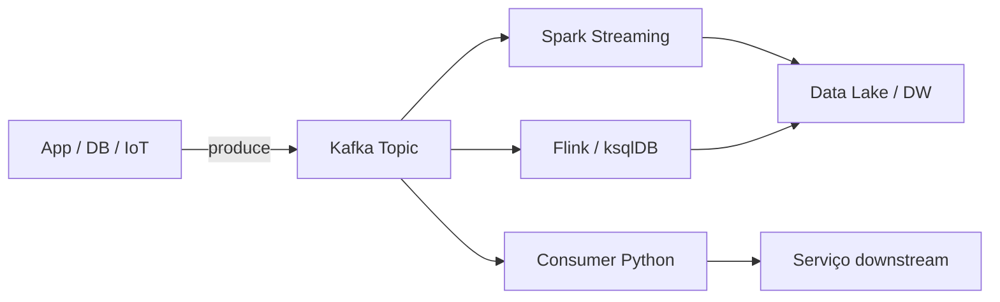

# Apache Kafka — Streaming e Eventos em Engenharia de Dados

> Aprenda **Kafka** para arquiteturas event-driven, **streaming** de dados em tempo real e integração com **Spark**, **Flink** e **pipelines ETL**.

[← Índice](../../README.md) · [Spark](../spark/README.md) · [Cloud](../cloud/README.md) · [Recursos](../resources/README.md)

---

## O que é Apache Kafka?

**Apache Kafka** é uma plataforma distribuída de streaming de eventos. Funciona como backbone de arquiteturas modernas de **engenharia de dados**, conectando produtores e consumidores de mensagens com alta throughput e durabilidade.

### Por que aprender Kafka?

- Base de arquiteturas real-time em fintechs, e-commerce e IoT
- Integração nativa com **Spark Structured Streaming**, Flink, ksqlDB
- Conceitos de event sourcing e CQRS
- Managed services: AWS MSK, Confluent Cloud, Azure Event Hubs

### Quando usar

| Kafka | Alternativa |
|-------|-------------|
| Eventos em tempo real entre sistemas | RabbitMQ para filas simples |
| Log de eventos imutável | S3 + batch para latência alta |
| Múltiplos consumidores independentes | Pub/Sub do GCP |
| Replay de eventos históricos | — |

**Importância:** ⭐⭐⭐⭐

---

## Conceitos fundamentais

| Termo | Descrição |
|-------|-----------|
| Topic | Canal de mensagens |
| Partition | Unidade de paralelismo |
| Offset | Posição no log |
| Consumer Group | Consumidores cooperativos |
| Broker | Servidor Kafka |
| Schema Registry | Contratos Avro/Protobuf |

---

## Recursos

### Documentação
- [Kafka Documentation](https://kafka.apache.org/documentation/)
- [Confluent Docs](https://docs.confluent.io/)

### Cursos
- Confluent Fundamentals (gratuito)
- Udemy — Apache Kafka Series

### Livros
- *Kafka: The Definitive Guide* — Neha Narkhede
- *Designing Event-Driven Systems* — Ben Stopford

### Projetos
- Producer/consumer Python com confluent-kafka
- Pipeline Kafka → Spark Streaming → Delta Lake
- Dead letter queue para mensagens inválidas

---

## Arquitetura Kafka em pipelines de dados



---

## Exemplo Producer/Consumer em Python

```python
# Producer
from confluent_kafka import Producer

p = Producer({"bootstrap.servers": "localhost:9092"})
p.produce("pedidos", key="123", value='{"valor": 99.90}')
p.flush()

# Consumer
from confluent_kafka import Consumer

c = Consumer({
    "bootstrap.servers": "localhost:9092",
    "group.id": "etl-pedidos",
    "auto.offset.reset": "earliest",
})
c.subscribe(["pedidos"])
msg = c.poll(1.0)
if msg and not msg.error():
    print(msg.value().decode("utf-8"))
```

---

## Estratégias de particionamento

| Estratégia | Quando usar | Trade-off |
|------------|-------------|-----------|
| Por `customer_id` | Eventos do mesmo cliente na mesma partição | Pode gerar hot partitions |
| Round-robin | Distribuição uniforme | Perde ordenação por chave |
| Por região/país | Dados geo-distribuídos | Bom para multi-region |
| Hash da chave | Ordenação garantida por chave | Monitorar skew |

**Regra prática:** número de partições ≈ `max(throughput_desejado / throughput_por_partição, número_de_consumers)`.

---

## Garantias de entrega

| Garantia | Descrição | Uso |
|----------|-----------|-----|
| **At-most-once** | Pode perder mensagens | Métricas, logs não críticos |
| **At-least-once** | Pode duplicar (padrão) | Maioria dos pipelines batch/streaming |
| **Exactly-once** | Sem perda nem duplicação | Transações Kafka + idempotent producer |

---

## Checklist de domínio Kafka

- [ ] Entendo topic, partition, offset e consumer group
- [ ] Sei calcular número de partições para throughput desejado
- [ ] Configuro `retention.ms` e `retention.bytes` adequadamente
- [ ] Implemento dead letter queue para mensagens inválidas
- [ ] Uso Schema Registry para contratos Avro/Protobuf
- [ ] Monitoro consumer lag (Confluent, Prometheus, CloudWatch)

---

[Streaming no guia principal](../../README.md#streaming) · [Entrevistas](../interview/README.md)

> 💡 O módulo **Kafka e Streaming** está previsto na trilha [DataEngineer.help](https://dataengineer.help).

[← Voltar ao Awesome Data Engineering BR](../../README.md)
