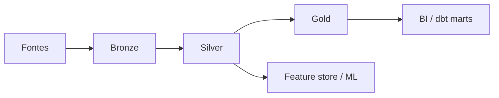

# Lakehouse — Arquitetura Medallion com Delta Lake e Apache Iceberg

> Aprenda **lakehouse** e a arquitetura **medallion** (bronze/silver/gold) com **Delta Lake** e **Apache Iceberg** para **engenharia de dados** moderna.

[← Índice](../../README.md) · [Architecture](../architecture/README.md) · [Data Warehouse](../data-warehouse/README.md) · [Spark](../spark/README.md) · [ETL](../etl/README.md) · [Recursos](../resources/README.md)

---

## O que é um lakehouse?

O **lakehouse** une o baixo custo e flexibilidade do **data lake** (arquivos no object storage) com confiabilidade de warehouse: **ACID**, schema evolution, time travel e SQL analítico. Formatos de tabela como **Delta Lake** e **Apache Iceberg** são o coração desse modelo.

Um **engenheiro de dados** usa lakehouse para:

- Ingerir raw barato (Parquet/JSON) com governança depois
- Aplicar camadas **bronze → silver → gold**
- Servir BI e ML a partir da mesma base
- Evoluir schemas sem reescrever o lago inteiro

**Importância:** ⭐⭐⭐⭐⭐

---

## O que você precisa dominar

| Tópico | Nível | Descrição |
|--------|-------|-----------|
| Object storage + Parquet | ⭐⭐⭐⭐⭐ | Base física do lake |
| Medallion (B/S/G) | ⭐⭐⭐⭐⭐ | Separação de responsabilidades |
| Delta Lake | ⭐⭐⭐⭐⭐ | ACID, OPTIMIZE, Z-ORDER |
| Apache Iceberg | ⭐⭐⭐⭐ | Table format aberto, multi-engine |
| Partitioning e compaction | ⭐⭐⭐⭐⭐ | Performance e small files |
| Time travel / vacuum | ⭐⭐⭐⭐ | Auditoria e limpeza |
| Catalog (Hive/Unity/Glue) | ⭐⭐⭐⭐ | Descoberta de tabelas |

---

## Quando usar lakehouse vs DW puro

| Cenário | Escolha |
|---------|---------|
| Raw + ciência + BI no mesmo storage | **Lakehouse** |
| Só SQL BI com time maduro em Snowflake/BQ | **Cloud DW** (+ talvez external tables) |
| Arquivos sem governança | Lake sem formato de tabela (evite a longo prazo) |
| Multi-engine (Spark + Trino + Flink) | **Iceberg** costuma brilhar |
| Ecossistema Databricks | **Delta** + Unity Catalog |

---

## Recursos recomendados

### Documentação oficial
- [Delta Lake](https://delta.io/)
- [Apache Iceberg](https://iceberg.apache.org/)
- [Parquet Docs](https://parquet.apache.org/docs/)

### Guias e cursos
- Databricks Academy — lakehouse fundamentals (trilhas gratuitas periódicas)
- Documentação Spark + Delta

### Projetos práticos
- Pipeline: CSV → bronze Delta → silver limpo → gold star
- Compactação de small files e verificação de time travel
- Tabela Iceberg lida por Spark e Trino

---

## Arquitetura medallion

```text
Bronze  — raw, append-only, schema mínimo / inferido
Silver  — tipado, deduplicado, qualidade, chaves
Gold    — marts dimensionais / agregados para BI e produto
```



---

## Exemplos práticos

### Escrita Delta (PySpark)

```python
(
  df.write
    .format("delta")
    .mode("append")
    .option("mergeSchema", "true")
    .save("s3://lake/bronze/events")
)
```

### MERGE (upsert) na silver

```sql
MERGE INTO silver.customers t
USING bronze.customers_cdc s
ON t.customer_id = s.customer_id
WHEN MATCHED THEN UPDATE SET *
WHEN NOT MATCHED THEN INSERT *;
```

### Delta vs Iceberg (visão rápida)

| Aspecto | Delta Lake | Apache Iceberg |
|---------|------------|----------------|
| Origem | Databricks / Linux Foundation | Netflix → ASF |
| ACID / time travel | Sim | Sim |
| Multi-engine | Bom (melhor no Spark/Databricks) | Excelente foco aberto |
| Compaction | OPTIMIZE | rewrite_data_files etc. |
| Catalog | metastore / Unity | Hive, REST, Glue, Nessie |

---

## Padrões operacionais

| Padrão | Quando usar | Exemplo |
|--------|-------------|---------|
| **Append-only bronze** | Reprocessamento fiel | Não update in-place no raw |
| **Partition por data** | Fatos e eventos | `event_date=YYYY-MM-DD` |
| **Compaction** | Muitos arquivos pequenos | OPTIMIZE / rewrite |
| **Z-ORDER / clustering** | Filtros seletivos | `customer_id` |
| **Vacuum / expire** | Custo de storage | Retenção alinhada a compliance |

---

## Anti-padrões comuns

- **Milhares de small files** sem compaction
- **Particionar por coluna de alta cardinalidade** (ex.: `user_id`)
- **Gold com lógica de limpeza** (deveria estar na silver)
- **Sem catalog** — paths espalhados sem descoberta
- **Time travel eterno** sem política de retenção ($$$)

---

## Checklist de domínio Lakehouse

- [ ] Explico lake vs warehouse vs lakehouse
- [ ] Desenho bronze/silver/gold com regras claras
- [ ] Uso Delta ou Iceberg com ACID e MERGE
- [ ] Particiono e compacto conscientemente
- [ ] Aplico time travel e retenção (vacuum/expire)
- [ ] Registro tabelas em um catalog
- [ ] Conecto BI/dbt aos marts gold

---

## Próximos passos na trilha

1. Encaixe no desenho em [Architecture](../architecture/README.md)
2. Processe com [Spark](../spark/README.md) e [ETL](../etl/README.md)
3. Modele gold em [Data Modeling](../data-modeling/README.md)
4. Compare serving em [Data Warehouse](../data-warehouse/README.md)

> 💡 O módulo **Tabelas Delta e Camadas Bronze/Silver/Gold** da trilha [DataEngineer.help](https://dataengineer.help) aprofunda lakehouse na prática.

---

[← Voltar ao Awesome Data Engineering BR](../../README.md)
