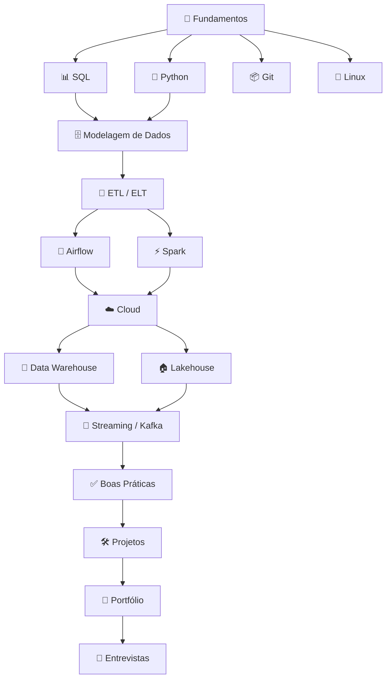

# Roadmap de Engenharia de Dados — Trilha Completa 2026

> O **roadmap engenharia de dados** definitivo em português. Do zero ao profissional pronto para o mercado brasileiro de **data engineering**.

[← Índice principal](../../README.md) · [SQL](../sql/README.md) · [Python](../python/README.md) · [Projetos](../projects/README.md)

---

## Visão geral da trilha

Este roadmap foi desenhado para quem quer **aprender engenharia de dados** de forma estruturada, cobrindo fundamentos, ferramentas de produção e preparação para o mercado.

---

## Fase 1 — Fundamentos (2–3 meses)

| Etapa | Tempo | Recursos |
|-------|-------|----------|
| SQL básico e avançado | 4–6 semanas | [Guia SQL](../sql/README.md) |
| Python para dados | 4–6 semanas | [Guia Python](../python/README.md) |
| Git e versionamento | 1–2 semanas | [README principal](../../README.md#git) |
| Linux e terminal | 2 semanas | [README principal](../../README.md#linux) |
| Docker básico | 1–2 semanas | [README principal](../../README.md#docker) |

**Objetivo:** Resolver problemas de manipulação de dados com SQL e Python, versionar código no GitHub.

---

## Fase 2 — Dados e Pipelines (2–3 meses)

| Etapa | Tempo | Recursos |
|-------|-------|----------|
| Modelagem dimensional | 2–3 semanas | [Data Modeling](../../README.md#data-modeling) |
| PostgreSQL | 2 semanas | [Recursos](../resources/README.md) |
| ETL/ELT conceitos | 2 semanas | [README principal](../../README.md#etl-e-elt) |
| Apache Airflow | 3–4 semanas | [Guia Airflow](../airflow/README.md) |
| dbt | 3 semanas | [Guia dbt](../dbt/README.md) |

**Objetivo:** Construir um pipeline batch completo com orquestração e transformações versionadas.

---

## Fase 3 — Escala e Cloud (3–4 meses)

| Etapa | Tempo | Recursos |
|-------|-------|----------|
| Apache Spark | 4–6 semanas | [Guia Spark](../spark/README.md) |
| Cloud (AWS/GCP/Azure) | 4–6 semanas | [Guia Cloud](../cloud/README.md) |
| Data Warehouse | 2–3 semanas | [README principal](../../README.md#data-warehouse) |
| Lakehouse | 2–3 semanas | [README principal](../../README.md#lakehouse) |
| Terraform | 2 semanas | [README principal](../../README.md#terraform) |

**Objetivo:** Processar datasets grandes, deploy em cloud, modelar camadas medallion.

---

## Fase 4 — Streaming e Produção (2 meses)

| Etapa | Tempo | Recursos |
|-------|-------|----------|
| Kafka | 3 semanas | [Guia Kafka](../kafka/README.md) |
| CI/CD para dados | 2 semanas | [Recursos](../resources/README.md) |
| Data Quality | 2 semanas | Great Expectations, dbt tests |
| Observabilidade | 1 semana | Logs, métricas, alertas |

---

## Fase 5 — Mercado (contínuo)

- [30+ projetos](../projects/README.md) no portfólio
- [Desafios práticos](../../README.md#desafios)
- [Entrevistas](../interview/README.md)
- [Certificações](../../README.md#certificacoes)
- Networking em [comunidades](../../README.md#comunidades)

---

## Plano de estudo semanal (modelo)

| Dia | Atividade | Duração |
|-----|-----------|---------|
| Segunda | Teoria + leitura de docs | 1–2h |
| Terça | Exercícios práticos (SQL/Python) | 1–2h |
| Quarta | Projeto hands-on | 2h |
| Quinta | Vídeo/curso da tecnologia da fase | 1–2h |
| Sexta | Newsletter + artigos + revisão | 1h |
| Sábado | Projeto de portfólio (bloco longo) | 3–4h |
| Domingo | Descanso ou leitura leve | — |

**Meta realista:** 8–12 horas/semana para quem trabalha em tempo integral.

---

## Matriz de competências por fase

| Competência | Fase 1 | Fase 2 | Fase 3 | Fase 4 | Fase 5 |
|-------------|--------|--------|--------|--------|--------|
| SQL avançado | ●●● | ●●●● | ●●●●● | ●●●●● | ●●●●● |
| Python para dados | ●●● | ●●●● | ●●●●● | ●●●●● | ●●●●● |
| Airflow | — | ●●● | ●●●● | ●●●●● | ●●●●● |
| dbt | — | ●●● | ●●●● | ●●●●● | ●●●●● |
| Spark | — | — | ●●● | ●●●● | ●●●●● |
| Cloud (1 provider) | — | — | ●●● | ●●●● | ●●●●● |
| Kafka/Streaming | — | — | — | ●●● | ●●●● |
| System design | — | — | ● | ●● | ●●●● |

---

## Marcos de validação (checkpoints)

### Após Fase 1
- [ ] Resolvo 20+ exercícios SQL (joins, window functions, CTEs)
- [ ] Escrevo script Python que lê CSV, transforma e grava em PostgreSQL
- [ ] Tenho repositório GitHub com commits regulares
- [ ] Subo ambiente local com Docker Compose (Postgres)

### Após Fase 2
- [ ] Pipeline Airflow rodando com pelo menos 3 tasks encadeadas
- [ ] Projeto dbt com staging + marts e testes passando
- [ ] Modelo dimensional (star schema) implementado em SQL

### Após Fase 3
- [ ] Job Spark processando Parquet particionado em S3 ou local
- [ ] Recursos cloud provisionados com Terraform
- [ ] Camadas bronze/silver/gold documentadas

### Após Fase 4
- [ ] Pipeline Kafka → consumer funcionando
- [ ] CI/CD rodando testes de DAG ou dbt em PR
- [ ] Monitoramento de freshness ou data quality ativo

### Após Fase 5
- [ ] 3+ projetos no GitHub com README e diagrama
- [ ] LinkedIn atualizado com stack e projetos
- [ ] Simulei 5+ entrevistas técnicas (SQL + system design)

---

## Ferramentas online do repositório

Use as ferramentas do hub para acelerar o aprendizado em cada fase:

| Fase | Ferramenta | Link |
|------|-----------|------|
| 1 — SQL | SQL Formatter | [tools/sql-formatter/](../../tools/sql-formatter/) |
| 1 — Dados | CSV Profiler, JSON↔CSV | [tools/](../../tools/) |
| 2 — Airflow | Explicador de Cron | [tools/cron-expression-explainer/](../../tools/cron-expression-explainer/) |
| 3 — Spark/Lakehouse | Parquet Viewer | [tools/parquet-viewer/](../../tools/parquet-viewer/) |

---

## Perfis de transição

| De | Foco inicial | Tempo estimado |
|----|--------------|----------------|
| Analista de dados | SQL avançado + Python + dbt | 6–9 meses |
| Desenvolvedor backend | SQL + Airflow + cloud | 4–6 meses |
| DBA | Python + Spark + cloud DW | 6–8 meses |
| Estudante | Fundamentos completos | 12–18 meses |

> 💡 Esta trilha segue a mesma progressão da grade do [DataEngineer.help](https://dataengineer.help) — dos fundamentos (SQL, Python, Shell) aos projetos de portfólio.

[← Voltar ao Awesome Data Engineering BR](../../README.md)
