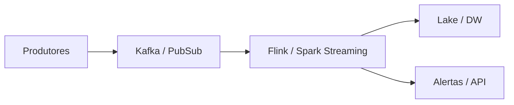

# Streaming em Tempo Real — Conceitos, Flink e Janelas (além do Kafka)

> Aprenda **streaming** de dados em tempo real: conceitos, **Apache Flink**, janelas, watermarks e padrões além do **Kafka** para **engenharia de dados**.

[← Índice](../../README.md) · [Kafka](../kafka/README.md) · [Spark](../spark/README.md) · [ETL](../etl/README.md) · [Architecture](../architecture/README.md)

---

## O que é streaming de dados?

**Streaming** processa eventos continuamente, com latência de segundos (ou menos), em vez de esperar um batch diário. O **Kafka** (ou similar) transporta eventos; engines como **Flink**, **Spark Structured Streaming** e **ksqlDB** transformam e agregam em movimento.

Um **engenheiro de dados** usa streaming para:

- Fraude, alertas e personalização em tempo quase real
- CDC e sincronização entre sistemas
- Métricas ao vivo e feature pipelines
- Arquiteturas event-driven e Lambda/Kappa

**Importância:** ⭐⭐⭐⭐

---

## O que você precisa dominar

| Tópico | Nível | Descrição |
|--------|-------|-----------|
| Eventos e logs imutáveis | ⭐⭐⭐⭐⭐ | Base do streaming |
| Kafka (transporte) | ⭐⭐⭐⭐⭐ | Ver [guia Kafka](../kafka/README.md) |
| Janelas (tumbling, hopping, session) | ⭐⭐⭐⭐⭐ | Agregações temporais |
| Watermarks e late data | ⭐⭐⭐⭐ | Event-time vs processing-time |
| Flink / Spark Streaming | ⭐⭐⭐⭐ | Engines de processamento |
| Exactly-once / idempotência | ⭐⭐⭐⭐ | Entrega confiável |
| Backpressure e lag | ⭐⭐⭐⭐ | Operação em produção |

---

## Quando usar streaming vs batch

| Cenário | Escolha |
|---------|---------|
| SLA de minutos/horas, custo baixo | **Batch** / micro-batch |
| Alertas e UX em segundos | **Streaming** |
| Replay e reprocessamento histórico | Log (Kafka) + consumers |
| Agregados complexos com event-time | **Flink** |
| Já no ecossistema Spark | Structured Streaming |

---

## Recursos recomendados

### Documentação
- [Apache Flink Docs](https://flink.apache.org/docs/)
- [Spark Structured Streaming](https://spark.apache.org/docs/latest/structured-streaming-programming-guide.html)
- [Kafka Documentation](https://kafka.apache.org/documentation/)

### Cursos e livros
- Confluent Fundamentals (gratuito)
- *Streaming Systems* — Akidau, Chernyak, Lax
- *Kafka: The Definitive Guide* — Narkhede et al.

### Projetos
- Contagem de eventos por janela tumbling
- Pipeline Kafka → Flink → sink (DW/lake)
- Dead letter queue para eventos inválidos

---

## Conceitos fundamentais

| Termo | Descrição |
|-------|-----------|
| **Event time** | Timestamp do evento na origem |
| **Processing time** | Quando o engine processa |
| **Watermark** | Limite de atraso tolerado |
| **Tumbling window** | Janelas fixas sem overlap |
| **Hopping / sliding** | Janelas com overlap |
| **Session window** | Gap de inatividade define o fim |
| **Stateful processing** | Estado keyed entre eventos |

---

## Exemplos práticos

### Tipos de janela (mental model)

```text
Tumbling 1 min:  [0-1)[1-2)[2-3)
Hopping 1 min / slide 30s: sobreposição parcial
Session (gap 5 min): agrupa atividade do usuário
```

### Agregação conceitual (SQL streaming)

```sql
-- Contagem por minuto (event time)
SELECT
  TUMBLE_START(event_ts, INTERVAL '1' MINUTE) AS window_start,
  customer_id,
  COUNT(*) AS pedidos
FROM pedidos
GROUP BY
  TUMBLE(event_ts, INTERVAL '1' MINUTE),
  customer_id;
```

### Arquitetura típica



---

## Flink vs Spark Structured Streaming (visão)

| Aspecto | Flink | Spark Structured Streaming |
|---------|-------|----------------------------|
| Modelo | True streaming (baixo latency) | Micro-batch (melhorando) |
| Estado | Muito forte (keyed state) | Bom, via Spark |
| Ecossistema | Foco stream | Unificado batch+stream |
| Curva | Mais íngreme | Familiar se já usa Spark |

---

## Anti-padrões comuns

- **Usar processing-time** quando o negócio exige event-time
- **Janela sem watermark** e late data “sumindo”
- **Estado infinito** sem TTL/cleanup
- **Exactly-once no transporte** mas sink sem idempotência
- **Streaming para tudo** quando batch diário bastaria

---

## Checklist de domínio Streaming

- [ ] Distingo batch, micro-batch e streaming
- [ ] Entendo event-time, watermarks e late data
- [ ] Escolho tumbling vs session conforme o caso
- [ ] Conheço Kafka como backbone de eventos
- [ ] Sei o papel de Flink e Spark Streaming
- [ ] Monitoro consumer lag e backpressure
- [ ] Desenho sinks idempotentes

---

## Próximos passos na trilha

1. Aprofunde transporte em [Kafka](../kafka/README.md)
2. Veja [Spark](../spark/README.md) para Structured Streaming
3. Encaixe no desenho em [Architecture](../architecture/README.md)
4. Compare com [ETL](../etl/README.md) batch

> 💡 O módulo **Kafka e Streaming** está previsto na trilha [DataEngineer.help](https://dataengineer.help).

---

[← Voltar ao Awesome Data Engineering BR](../../README.md)
